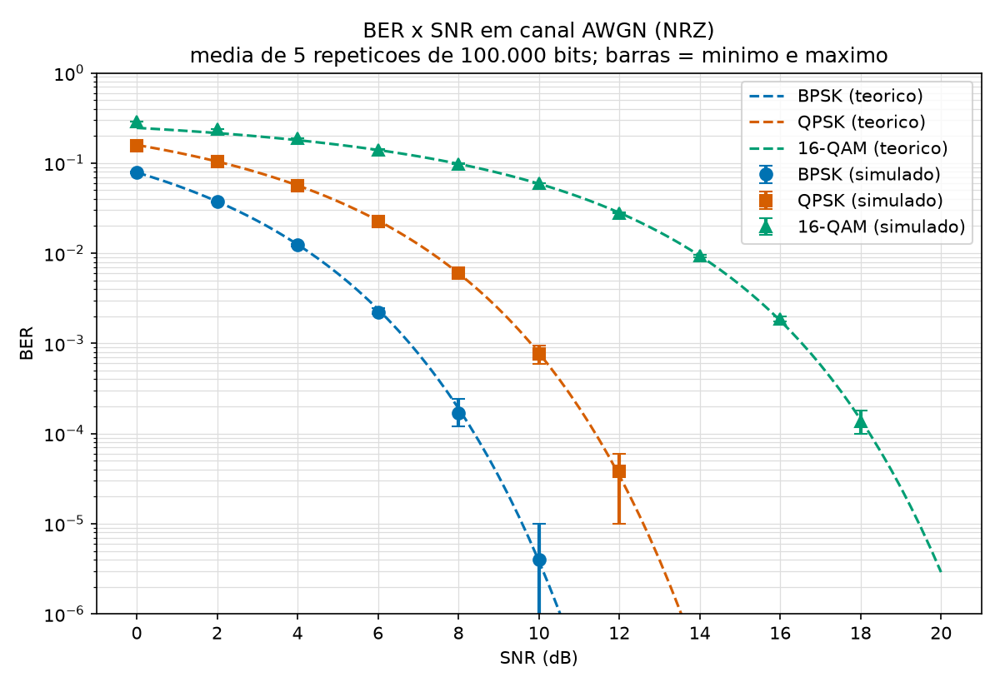
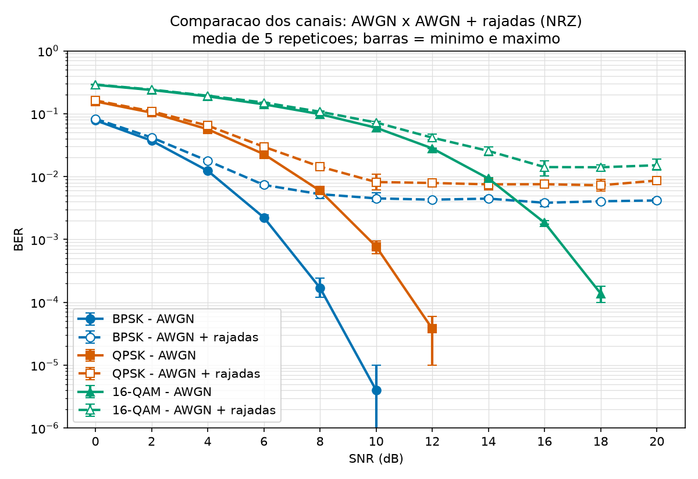
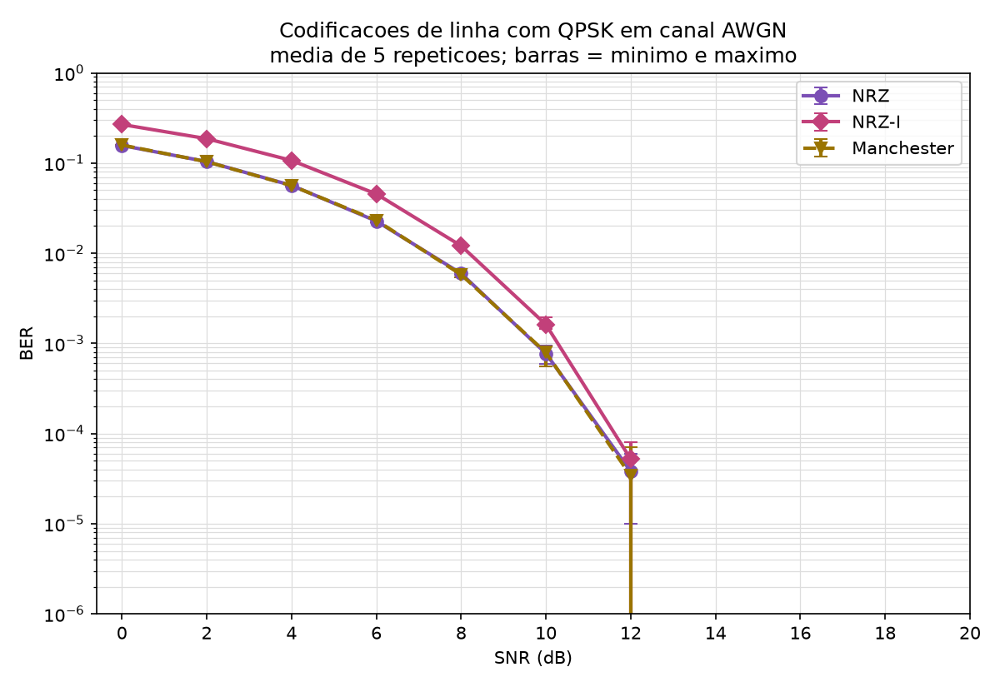
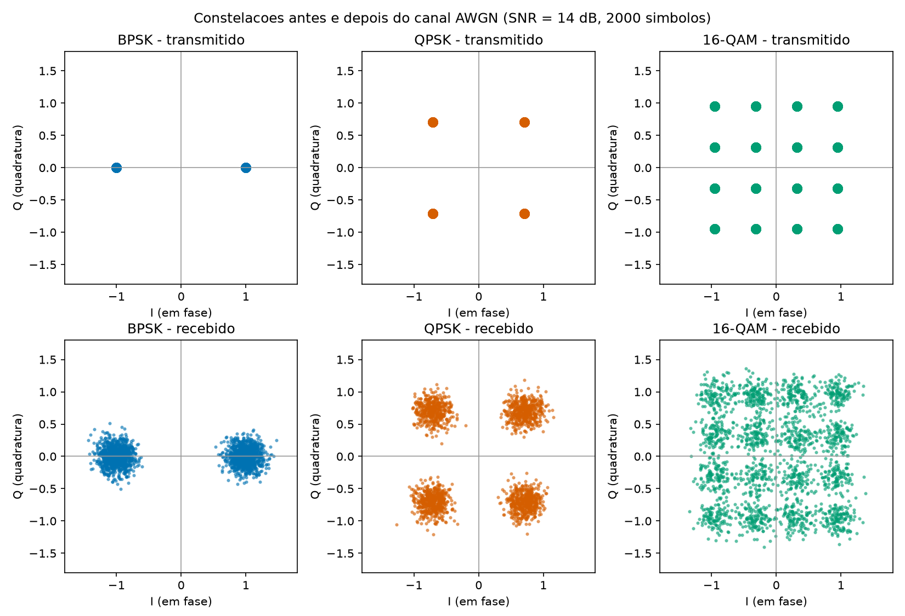

# Trabalho II — Simulador de Transmissão Digital

Redes de Computadores: Internetworking, Roteamento e Transmissão — Unisinos, 2026/2
Prof. Cristiano Bonato Both

**Dupla:** Fábio Silveira e Pedro Scott

**Vídeo de demonstração:** _(PLACEHOLDER ENQUANTO GRAVAMOS)_

## 1. O que o trabalho faz

Simulamos um enlace de comunicação digital completo, do texto até o texto de novo:

```
texto ASCII -> bits -> codificação de linha -> modulação -> canal com ruído
            -> demodulação -> decodificação de linha -> bits -> texto
```

Com isso medimos a taxa de erro de bits (BER) para diferentes modulações, diferentes
valores de SNR e dois tipos de canal, e comparamos a BER com a eficiência espectral
de cada modulação.

| Item do enunciado | O que implementamos |
| --- | --- |
| Mensagem ASCII em binário | `texto_para_bits` e `bits_para_texto` (8 bits por caractere) |
| Codificações de linha | NRZ (referência), NRZ-I e Manchester |
| Modulações | BPSK, QPSK e 16-QAM (ordem superior) |
| Canal 1 | AWGN com SNR controlada |
| Canal 2 | AWGN + ruído impulsivo em rajadas |
| Métricas | BER, posições dos bits errados e eficiência espectral nominal |

## 2. Como instalar e executar

Precisa de Python 3 e três bibliotecas:

```
pip install -r requirements.txt
```

Depois, dentro da pasta do projeto, nesta ordem:

```
python3 teste_consistencia.py   # mensagem ASCII ponta a ponta (1 segundo)
python3 experimentos.py         # roda os 990 ensaios (cerca de 25 segundos)
python3 graficos.py             # gera as figuras e as tabelas
```

As sementes aleatórias são fixas, então rodar de novo gera exatamente os mesmos números.

## 3. Organização do repositório

| Arquivo | Conteúdo |
| --- | --- |
| `simulador.py` | Todas as funções do simulador (seção 4) |
| `teste_consistencia.py` | Teste em canal ideal e SNR alta, e demonstração com a mensagem |
| `experimentos.py` | Varredura de SNR com repetições; grava os resultados brutos |
| `graficos.py` | Lê os resultados brutos e gera figuras e tabelas |
| `resultados/configuracao.json` | Parâmetros usados nos experimentos |
| `resultados/resultados_brutos.csv` | Uma linha por ensaio (990 linhas) |
| `resultados/tabela_resumo.csv` | Média, desvio padrão, mínimo e máximo da BER |
| `resultados/tabela_compromisso.csv` | BER x eficiência espectral |
| `resultados/teste_consistencia.txt` | Saída do teste de consistência |
| `figuras/` | As quatro figuras deste README |

## 4. Arquitetura do simulador

O simulador é um conjunto de funções em `simulador.py`, uma para cada etapa. A função
`transmitir` chama todas em sequência.

### 4.1 Codificação de linha

A codificação de linha recebe os bits e devolve uma sequência de níveis (0 = baixo, 1 = alto).

| Código | Regra | Níveis por bit |
| --- | --- | --- |
| NRZ | bit 1 = nível alto, bit 0 = nível baixo | 1 |
| NRZ-I | bit 1 = inverte o nível, bit 0 = mantém o nível (nível inicial 0) | 1 |
| Manchester (IEEE 802.3) | bit 0 = alto-baixo, bit 1 = baixo-alto (sempre há transição no meio do bit) | 2 |

O NRZ serve de referência porque não altera os bits. Na decodificação do Manchester,
os pares `00` e `11` não existem no código; quando aparecem, sabemos que houve erro e
contamos como "violação".

**Codificação de linha x codificação de correção de erros.** A codificação de linha
só define como os bits viram níveis de sinal. O objetivo dela é ajudar o receptor no
sincronismo (as transições do Manchester servem de relógio) e evitar longas sequências
sem mudança de nível. Ela não protege os dados. Já um código de correção de erros,
como o Hamming visto em aula, acrescenta bits de redundância calculados a partir dos
dados para o receptor conseguir detectar e corrigir erros. O Manchester até dobra a
quantidade de níveis transmitidos, mas isso não é redundância para correção: no
máximo ele percebe que um par é inválido, sem saber qual era o bit certo.
Neste trabalho não usamos nenhum código de correção de erros.

### 4.2 Modulação

Cada símbolo é um número complexo (parte real = componente I, parte imaginária =
componente Q). Todas as constelações têm potência média 1, para a comparação ser justa.

| Modulação | Bits por símbolo | Mapeamento |
| --- | --- | --- |
| BPSK | 1 | bit 0 = +1, bit 1 = −1 |
| QPSK | 2 | 1º bit define o sinal de I, 2º bit define o sinal de Q; divide por √2 |
| 16-QAM | 4 | 2 bits para I e 2 para Q, níveis −3, −1, +1, +3 em código Gray (00, 01, 11, 10); divide por √10 |

A demodulação escolhe o ponto da constelação mais próximo: olha o sinal de cada eixo
(BPSK e QPSK) ou compara com os limiares −2, 0 e +2 (16-QAM). Se a quantidade de
níveis não for múltipla dos bits por símbolo, completamos com zeros e descartamos
esses zeros na recepção.

### 4.3 Canais

**AWGN.** Soma ruído gaussiano nos eixos I e Q. A SNR é a potência do sinal dividida
pela potência do ruído. Como o sinal tem potência 1, a potência do ruído é
`1 / SNR`, com `SNR = 10^(SNR_dB / 10)`. A SNR é sempre por símbolo.

**AWGN + rajadas.** É o AWGN acima mais um ruído impulsivo. Cada símbolo tem 0,1% de
chance de iniciar uma rajada de 50 símbolos, e durante a rajada é somado um ruído
extra com a mesma potência do sinal. Esse ruído extra não depende da SNR: representa
uma interferência externa. Com esses valores, cerca de 5% dos símbolos são atingidos.

### 4.4 Métricas

- **BER** = bits errados / bits transmitidos, comparando os bits de informação
  enviados com os recuperados depois da decodificação de linha.
- **Eficiência espectral nominal** = bits por símbolo (log₂ M), considerando banda
  igual à taxa de símbolos: BPSK = 1, QPSK = 2 e 16-QAM = 4 bits/s/Hz. Com Manchester
  cai pela metade, porque são transmitidos 2 níveis para cada bit de informação.

## 5. Plano experimental

| Parâmetro | Valor |
| --- | --- |
| SNR | 0 a 20 dB em passos de 2 dB (11 valores) |
| Bits por ensaio | 100.000 bits de informação aleatórios |
| Repetições | 5, com sementes 2026 a 2030 |
| Modulações | BPSK, QPSK, 16-QAM |
| Codificações de linha | NRZ, NRZ-I, Manchester |
| Canais | AWGN e AWGN + rajadas |
| Total | 3 × 3 × 2 × 11 × 5 = 990 ensaios |

Em cada repetição os mesmos 100.000 bits passam por todas as combinações, e a
potência do sinal é sempre 1. Assim, o que muda entre as curvas é só a modulação, o
código de linha ou o canal.

Com 100.000 bits, a menor BER que um ensaio consegue medir é 1/100.000 = 10⁻⁵.
Quando a tabela mostra BER = 0, significa "nenhum erro em 500.000 bits", ou seja,
abaixo do que conseguimos medir, e não que o erro seja impossível.

## 6. Resultados

### 6.1 Teste de consistência

Mensagem: `Redes de Computadores - Unisinos 2026/2 - Trabalho II` (53 caracteres, 424 bits).

Em canal ideal e em AWGN com 30 dB, a mensagem voltou idêntica nas 9 combinações de
código de linha e modulação (18 execuções, 0 bits errados). Não houve divergência.

Com ruído (AWGN, 6 dB), o programa mostra a mensagem recebida e as posições dos bits errados:

| Combinação | Mensagem recebida | Bits errados |
| --- | --- | --- |
| NRZ + BPSK | `Redes $e Computadore3 -(Unisinos 2026/2 - Trabalho II` | 3 de 424 |
| NRZ + QPSK | `Redes d% CoePutado2es - Unisinos(0r26/2 ? Traba?ho II` | 10 de 424 |
| NRZ + 16-QAM | ilegível (41 dos 53 caracteres afetados) | 61 de 424 |

A saída completa está em `resultados/teste_consistencia.txt`.

### 6.2 BER x SNR em canal AWGN



Os pontos são a média das 5 repetições e as barras vão do menor ao maior valor
obtido. As linhas tracejadas são as curvas teóricas.

- Para a mesma SNR, quanto mais bits por símbolo, maior a BER. Para chegar a BER de
  10⁻³, o BPSK precisou de 8 dB, o QPSK de 10 dB e o 16-QAM de 18 dB (primeiro valor
  simulado em que a BER média ficou abaixo de 10⁻³).
- O motivo aparece na Figura 4: com a mesma potência, os pontos do 16-QAM ficam
  muito mais próximos uns dos outros, então um ruído menor já faz o receptor errar.
- Os pontos simulados ficam em cima das curvas teóricas. No 16-QAM, com SNR baixa
  (0 a 4 dB), a simulação fica um pouco acima porque a fórmula que usamos é uma
  aproximação válida para SNR média e alta.
- A variabilidade é pequena quando há muitos erros e cresce quando há poucos. No
  QPSK a 8 dB, as repetições tiveram entre 574 e 632 erros. No BPSK a 10 dB, tiveram
  entre 0 e 1 erro, por isso a barra é grande. Pontos com poucos erros são menos confiáveis.

### 6.3 AWGN x AWGN com rajadas



- Com SNR baixa os dois canais são quase iguais, porque o ruído AWGN já domina.
- Com SNR alta, o canal com rajadas para de melhorar e a BER fica presa em um piso:
  cerca de 0,4% no BPSK, 0,8% no QPSK e 1,5% no 16-QAM. Aumentar a potência do sinal
  em relação ao ruído AWGN não resolve, pois a rajada não depende dessa SNR.
- O piso bate com uma conta simples: cerca de 5% dos símbolos são atingidos e,
  dentro da rajada, a SNR é de aproximadamente 0 dB. No BPSK, a BER a 0 dB é 7,9%, e
  5% × 7,9% ≈ 0,4%.
- Os erros ficam agrupados. Transmitindo a mensagem 40 vezes com QPSK a 20 dB, 30
  cópias chegaram perfeitas e 10 chegaram com um trecho destruído, por exemplo
  ``Redes de Cme`7tP?oRg?`? Unisinos 2026/2 - Trabalho II``. No AWGN com a mesma SNR
  não haveria nenhum erro.

### 6.4 Codificações de linha



- **NRZ-I** tem aproximadamente o dobro da BER do NRZ. Como cada bit é decidido
  comparando dois níveis seguidos, um nível errado estraga dois bits. No teste com a
  mensagem isso aparece nas posições dos erros, que vêm em pares (55 e 56, 91 e 92...).
- **Manchester** tem a mesma BER do NRZ com QPSK, mas gasta o dobro de símbolos para
  enviar os mesmos bits. Em compensação, detecta parte dos erros: no QPSK a 8 dB
  foram em média 579 bits errados e 1.163 violações detectadas por ensaio.
- Com 16-QAM, o Manchester ficou um pouco pior que o NRZ (1,24% contra 0,93% a
  14 dB). No 16-QAM os 4 bits de um símbolo não têm a mesma proteção, e do jeito que
  decodificamos, o bit decidido cai sempre nas posições mais fracas do símbolo.

### 6.5 Constelações



Com 14 dB, as nuvens do BPSK e do QPSK ficam bem separadas (quase nenhum erro),
enquanto as do 16-QAM já se encostam (BER perto de 1%).

### 6.6 Compromisso entre BER e eficiência espectral

Canal AWGN, codificação NRZ, média de 5 repetições de 100.000 bits.

| Modulação | Eficiência (bits/s/Hz) | BER a 6 dB | BER a 10 dB | BER a 14 dB | BER a 20 dB | SNR para BER ≤ 10⁻³ | BER a 20 dB com rajadas |
| --- | --- | --- | --- | --- | --- | --- | --- |
| BPSK | 1 | 2,2 × 10⁻³ | 4,0 × 10⁻⁶ | 0 | 0 | 8 dB | 4,2 × 10⁻³ |
| QPSK | 2 | 2,3 × 10⁻² | 7,7 × 10⁻⁴ | 0 | 0 | 10 dB | 8,6 × 10⁻³ |
| 16-QAM | 4 | 1,4 × 10⁻¹ | 6,0 × 10⁻² | 9,3 × 10⁻³ | 0 | 18 dB | 1,5 × 10⁻² |

Quando cada modulação é mais adequada:

- **BPSK:** canal ruim (SNR abaixo de uns 10 dB) ou quando o mais importante é não
  errar. É a mais robusta, mas a que menos aproveita a banda.
- **QPSK:** bom meio-termo. Dobra a taxa na mesma banda e precisa de só 2 dB a mais
  que o BPSK para a mesma BER.
- **16-QAM:** só vale a pena com SNR alta (18 dB ou mais nos nossos testes). Nesse
  caso transmite 4 vezes mais que o BPSK na mesma banda. Abaixo disso, a mensagem
  chega muito corrompida.

Isso combina com o teorema de Shannon visto em aula: para colocar mais bits por
símbolo na mesma banda, é preciso uma SNR maior.

## 7. Conclusões

1. A cadeia funciona de ponta a ponta: sem ruído, a mensagem é sempre recuperada.
2. Mais bits por símbolo significa mais eficiência espectral e menos tolerância a
   ruído. O 16-QAM precisou de 10 dB a mais que o BPSK para a mesma BER de 10⁻³.
3. Os resultados em AWGN concordam com as curvas teóricas, o que dá confiança no simulador.
4. Ruído em rajadas cria um piso de erro que aumentar a SNR não resolve, e os erros
   chegam concentrados. Para esse tipo de canal seria necessário correção de erros
   com entrelaçamento, que ficaram fora do escopo.
5. A codificação de linha não corrige erros. O NRZ-I dobra os erros e o Manchester
   custa metade da eficiência, em troca de sincronismo e detecção de pares inválidos.

## 8. Limitações

- Os símbolos são simulados em banda base (pontos I/Q), sem gerar a portadora
  senoidal amostrada no tempo.
- O receptor conhece exatamente o início dos símbolos, então o sincronismo, que é a
  principal vantagem do Manchester, não é avaliado.
- BER abaixo de 10⁻⁵ não é medida com 100.000 bits por ensaio.

## 9. Divisão de responsabilidades

| Integrante | Responsabilidades |
| --- | --- |
| Fábio Silveira | Conversão ASCII ↔ bits; codificações de linha (NRZ, NRZ-I e Manchester) e detecção de violações; canal com rajadas; teste de consistência e demonstração com a mensagem (`teste_consistencia.py`) |
| Pedro Scott | Modulações e demodulação (BPSK, QPSK e 16-QAM com código Gray); canal AWGN; métricas (BER e eficiência espectral); plano experimental (`experimentos.py`); gráficos, curvas teóricas e tabelas (`graficos.py`) |
| Ambos | Definição do plano experimental, análise dos resultados, redação do README, gravação do vídeo e apresentação |
